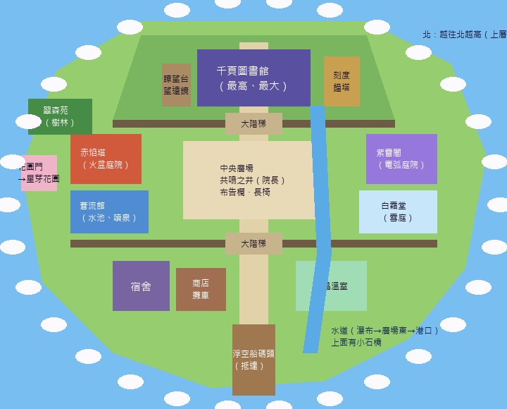

# 《魔數學院》地圖設計

> 2026-11-25。使用者決定：美術全部像素、地圖由 Claude 擺，「擺得好看，不會就上網找參考」。
> 地圖改成**資料檔**（地磚層＋物件層＋事件層）＋**物件清單**（每個物件自帶碰撞）＋**自動檢查**，不再用腳本算座標。

## 1. 參考來的原則

| 原則 | 從哪學的 | 學院島怎麼用 |
|---|---|---|
| 先畫大塊地形，再接路；先想玩家怎麼走，再補細節 | 俯視地圖編輯的教學（DEV Community） | 先定三層台地和中軸線，最後才放小物件 |
| 路在中間的小廣場交會，廣場就是焦點 | RPG 小鎮版面文章 | 中央廣場＝共鳴之井，所有路都通到這裡 |
| 越往地圖上方越高（早期寶可夢、FF 的城鎮） | 俯視城市設計（App2Top） | 北邊最高的台地放千頁圖書館，從港口一路往上走 |
| 高低差讓區域變密 | 2D 俯視關卡 devlog | 三層台地＋大階梯＋崖，比平面排建築有層次 |
| 常走的路鋪石板、不常走的是泥土路 | Stardew 地圖製作指南（Tael's Guide） | 中軸線石板路；去學院的小路是泥土路 |
| 用地面材質分區 | 俯視地圖編輯的教學 | 港口木板、廣場石板、學院區石板小路、花園門泥土 |
| 死路盡頭一定要有東西 | 俯視城市設計 | 每條小路的盡頭是學院、瞭望台、花園門或寶箱 |
| 景點分散，引玩家走遍（遊樂園式） | Stardew 地圖分析（PCGamesN） | 學院、商店、溫室、瞭望台散在三層台地上 |
| 用玩家實際看到的大小檢查 | 俯視地圖編輯的教學 | 每次擺完用手機大小截圖看 |

## 2. 學院島 v5 版面

- **島**：不是正圓；北邊寬、南邊收成港口，外圈一圈雲。大約 72×58 格（一格 16 像素）。
- **三層台地**（越北越高）：
  - **上層**：千頁圖書館（最高、最大），旁邊刻度鐘塔、瞭望台（望遠鏡）。
  - **中層**：中央廣場（共鳴之井、院長、布告欄），五座學系學院圍成扇形，各有自己的小庭院。翠森苑在西北的樹林邊。
  - **下層**：港口生活區——宿舍、商店（攤車）、分晶溫室、浮空船碼頭。
- **中軸線**：碼頭 → 大階梯 → 中央廣場 → 大階梯 → 圖書館，全程石板路。
- **水道**：從圖書館台地邊的瀑布流下來，經過廣場東邊，流到港口；上面有小石橋。
- **出口**：西邊花園門 → 星芽花園。

## 3. 地圖資料（給程式讀）

- `assets/map/<地圖>/map.json`：
  - `ground`：地磚層（每格一個地磚代號）。
  - `objects`：物件層（物件代號＋位置）。
  - `events`：事件層（門口、傳送、NPC、寶箱、墨水怪）。
- `src/world/catalog.js`：物件清單。每種物件寫圖、腳底的點、哪一塊不能走、門口在哪。
- 碰撞＝地磚本身（水、崖不能走）＋每個物件自己的碰撞，不另外手寫。
- `tools/check-maps.mjs`：自動檢查每個門口、事件都走得到，東西不疊在一起、不擋路。推上去之前跑。

## 4. 需要的新美術

見 [美術提示詞-v5.md](美術提示詞-v5.md)。全部照同一把尺規（`art/1-參考原圖/map-v5/ruler.png`）生，像素大小才會一樣。

## 參考資料

- [Editing a Top-Down 2D Map: Paths, Regions, and Elevation（DEV Community）](https://dev.to/spriteship/editing-a-top-down-2d-map-paths-regions-and-elevation-1pa7)
- [RPG Town: layout](https://prosepoetrycode.potterpcs.net/2016/12/rpg-town-layout/)
- [How to design a city for a game with a view from above（App2Top）](https://app2top.com/game_development/how-to-design-a-city-for-a-game-with-a-view-from-above-tips-from-an-architectural-designer-195671.html)
- [Devlog：設計關卡地圖](https://itch.io/devlog/680529/devlog-05-designing-the-level-maps.amp)
- [Tael's Guide to good map making（Stardew）](https://stardewmodding.wiki.gg/wiki/Tael%27s_Guide_to_good_map_making)
- [Stardew Valley map design（PCGamesN）](https://www.pcgamesn.com/stardew-valley/stardew-valley-map-design)
- [Verdant 02 — Elevation Tileset（台地、崖的地磚參考）](https://csaf.itch.io/verdant-02-elevation)
- [The Field of the Floating Islands（浮空島地磚參考）](https://lpc.opengameart.org/node/24731)
